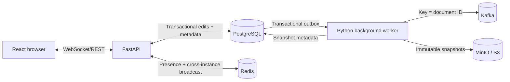

# SyncSpace ✦

A Google Docs–style collaborative **plain-text** document editor with Python/FastAPI, React/TypeScript, PostgreSQL, Redis, Apache Kafka, MinIO object storage, WebSockets, and server-side Operational Transformation (OT).

> **Status:** Runnable local-development MVP, not a production Google Docs replacement. Features include authentication, document CRUD, editor/viewer sharing, concurrent edits, presence, revision sequencing, Kafka event streaming, and MinIO snapshots. No rich-text formatting, images, offline guarantees, granular restore UI, or automated deployment are implemented.

## Quick start

Requires Docker Engine + Docker Compose v2. About 4–6 GB RAM recommended for all services.

```bash
git clone <your-repository-url> syncspace  # Or extract the provided ZIP
cd syncspace
docker compose up --build
```

- **Frontend:** http://localhost:5173
- **FastAPI Swagger API:** http://localhost:8000/docs
- **MinIO console:** http://localhost:9001 (development-only credentials `minioadmin` / `minioadmin123`)

Register two users in two browser sessions, create a document, share it with the second username, and edit together.

Stop services: `docker compose down`. Reset *all development data*: `docker compose down -v`.

> Do not expose development credentials, the Docker Compose services, or the default JWT key to the internet. Change secrets, configure TLS, and harden the architecture before any real deployment.

## Architecture



### What each component does

| Technology | Implemented role |
| --- | --- |
| FastAPI/Python | REST, authentication, OT, WebSocket server |
| React/TypeScript | Document dashboard, editor, sharing modal, optimistic local changes |
| PostgreSQL | Document state, ACLs, atomic revision ordering, operation history, outbox, snapshot index |
| Redis | WebSocket fan-out across API workers, expiring user presence, snapshot-request notifications |
| Kafka | Partition-keyed durable operation event stream written by outbox worker |
| MinIO | S3-compatible immutable document snapshots |
| OT | Rebase stale client edits against committed insertions/deletions |

**Important deviation from the initial Kafka-first draft:** PostgreSQL is the primary authoritative edit log and transaction sequencer, while Kafka is an asynchronously published durable stream. This design avoids the dual-write failure between Kafka and PostgreSQL. Kafka delivery is **at least once**; consumers must deduplicate by `(document_id, revision)`.

## Collaboration protocol

WebSocket endpoint: `ws://localhost:8000/ws/{document_id}?token=<JWT>`

Client sends:

```json
{
  "type":"edit",
  "operation_id":"unique-uuid",
  "base_revision":0,
  "pos":0,
  "delete":0,
  "insert":"Hello"
}
```

The server locks the document row with PostgreSQL `SELECT FOR UPDATE`, checks permissions, transforms the edit against all subsequent revisions, and saves the new authoritative content + operations + outbox event **in a single database transaction**. After commit the server broadcasts the operation through Redis Pub/Sub. A background worker writes outbox events to Kafka using `document_id` as the partition key and periodically snapshots the document in MinIO.

**Editor constraints:** The MVP uses code-point-based plain-text edits. One local edit is in flight at a time; the browser uses diff-match-patch to rebase unsent edits after acknowledgements, which is best-effort. A production editor should use a rigorously tested bidirectional OT client protocol, durable reconnect queues, and established rich-text OT semantics.

## Project structure

```text
syncspace/
├── docker-compose.yml
├── README.md
├── backend/
│   ├── Dockerfile
│   ├── requirements.txt
│   ├── app/
│   │   ├── config.py        # Environment settings
│   │   ├── database.py      # SQLAlchemy async engine
│   │   ├── models.py        # PostgreSQL schema
│   │   ├── security.py      # Password hashing/JWT/ACL
│   │   ├── ot.py            # Operational Transformation
│   │   ├── main.py          # REST + WebSocket endpoints
│   │   └── worker.py        # Kafka outbox and S3 snapshots
│   └── tests/test_ot.py
└── frontend/
    ├── Dockerfile
    ├── package.json
    ├── index.html
    └── src/
        ├── api.ts
        ├── ot-client.ts
        ├── main.tsx
        └── style.css
```

## Run tests

```bash
cd backend
python -m pip install -r requirements.txt
PYTHONPATH=. python -m pytest tests -q
```

Windows PowerShell equivalent:

```powershell
cd backend
py -m pip install -r requirements.txt
$env:PYTHONPATH = "."
py -m pytest tests -q
```

Frontend type checking and bundling:

```bash
cd frontend
npm install
npx tsc --noEmit
npm run build
```

## API routes

- `POST /auth/register`, `POST /auth/login`, `GET /me`
- `GET /documents`, `POST /documents`
- `GET /documents/{id}`, `PATCH /documents/{id}`, `DELETE /documents/{id}`
- `POST /documents/{id}/share` (owner only)
- `GET /documents/{id}/history` (snapshot revision list)
- `POST /documents/{id}/snapshot` (request immutable MinIO snapshot)
- `WS /ws/{id}` (collaborative editing, cursors, presence)
- `GET /health`

## Production hardening backlog

1. Add Alembic migrations; avoid `create_all()` in production.
2. Add a rigorously proven OT client/server protocol, including simultaneous deletes, replacements, out-of-order events, rich-text attributes, and cursor transforms.
3. Add WebSocket reconnect/resync queues, offline edits, and replay from last acknowledged revision.
4. Implement permission-revocation notifications for active sockets and Kafka/Redis failure recovery after DB commits.
5. Use a multi-broker Kafka deployment, TLS/SASL, topic retention policies, event archiving, and outbox pruning.
6. Add transactional snapshots/restore APIs, snapshot consistency checks, and restore-to-version UI.
7. Add Kubernetes ingress, autoscaling, OAuth, rate limits, audit logging, OpenTelemetry and production metrics.
8. Replace development defaults with strong secrets, managed infrastructure, backups, and access controls.

## License

MIT — example application for learning and experimentation.
